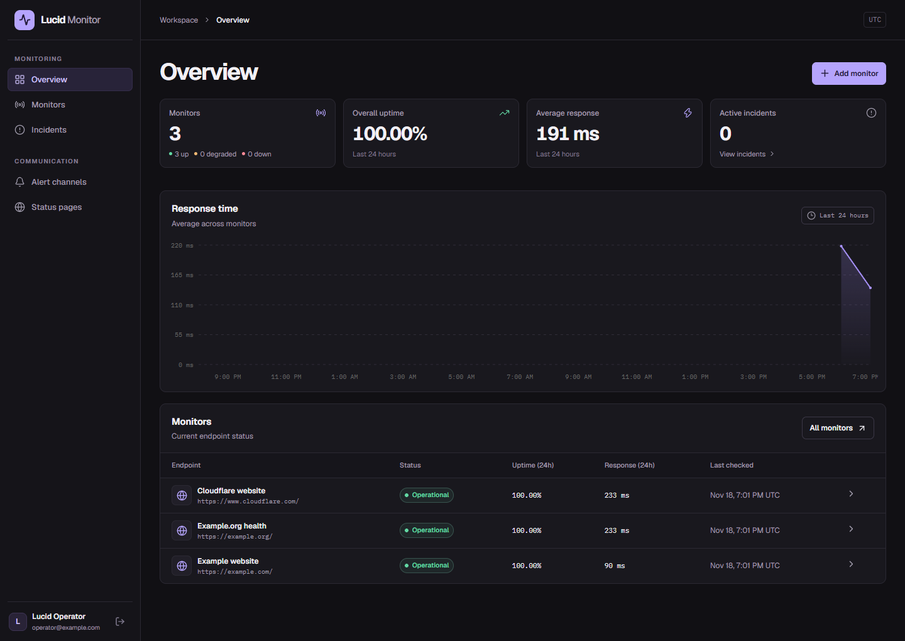
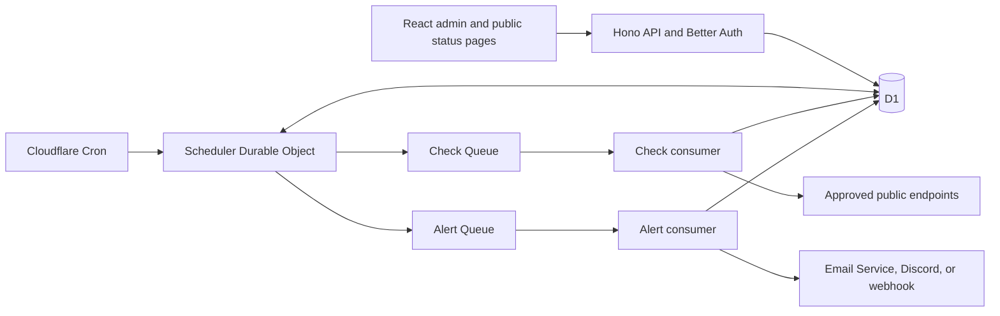
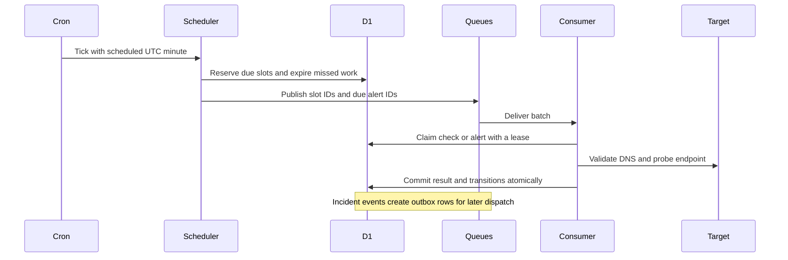

# Lucid Monitor

Self-hosted uptime monitoring and observability on Cloudflare Workers, with distributed health checks, incident tracking, alerts, and public status pages.

Lucid Monitor tracks public websites and APIs from a Cloudflare Worker. It gives small teams an authenticated dashboard, a documented REST API, and shareable status pages backed by the same check history.



[Monitor detail](docs/monitor-detail.png) · [Public status page](docs/status-page.png)

## Features

- Periodic HTTP and HTTPS GET or HEAD checks with expected status, substring validation, deadlines, and slow-response thresholds.
- Operational, degraded, down, paused, and unknown states with configurable outage and recovery confirmation.
- Latency charts and uptime history for 24 hours, 7 days, 30 days, and 90 days. Empty buckets and missed slots have distinct treatment from passing checks.
- Incident timelines, acknowledgements, resolution, private annotations, and asynchronous email, Discord, and webhook alerts.
- Public status pages with selected services, uptime history, incident history, and light and dark themes.
- Invite-only accounts, owner-scoped access, encrypted alert destinations, and operator-approved outbound hostnames.
- Domain expiry from RDAP when the registry publishes it. An optional self-hosted TLS inspector reports the live SNI certificate expiry.

## Architecture



TypeScript runs across the Worker, React UI, tests, and optional TLS inspector. The frontend uses Tailwind CSS, Recharts, and Vite. Better Auth uses Drizzle with D1. D1 SQL triggers update check aggregates, incident transitions, and the alert outbox in the same write transaction.

### Monitoring workflow



Each check has a unique monitor, configuration generation, and scheduled minute. The scheduler serializes ticks through a Durable Object. D1 uniqueness constraints and guarded claims keep repeated alerts and check deliveries from mutating state twice. Monitor state advances in scheduled order using a high-water mark, while a late completed slot can still contribute to history. A slot that expires without a result becomes missed. Longer scheduling gaps are recorded in hourly aggregates so the dispatcher can resume current checks immediately. An unavailable queue can recover on a later Cron tick while the slot is still current.

## Run locally

Requirements are Node 24 LTS, pnpm 11, and outbound HTTPS access to the monitored hosts and Cloudflare's public DNS resolver. Wrangler emulates D1, Durable Objects, and Queues locally and does not require an account for these commands.

```bash
pnpm install --frozen-lockfile
cp .dev.vars.example .dev.vars
node -e "console.log(require('node:crypto').randomBytes(48).toString('base64'))"
node -e "console.log(require('node:crypto').randomBytes(32).toString('base64'))"
pnpm db:local
pnpm build
pnpm dev
```

Before starting Wrangler, put the first random value in `AUTH_SECRET` and the second in `ALERT_ENCRYPTION_KEY`. Generate a separate random `REGISTRATION_KEY`, and add the exact hostnames you trust to `OUTBOUND_HOSTS`. Set `DEBUG_LOGGING=true` for scheduler counts and metadata diagnostics when developing locally.

Open [the local dashboard](http://localhost:8787), create an account with the registration key, and add `https://example.com/` if you kept the example allowlist. A new monitor starts at the next minute boundary. At or after that boundary, invoke the local Cron handler. Wrangler's local Cron requires an explicit trigger.

```bash
curl -fsS 'http://localhost:8787/__scheduled?cron=*+*+*+*+*'
```

Run another scheduled tick at the following minute for the default two-check recovery confirmation. Refresh the dashboard once the local queue delivers its batch. The stored checks come from the actual outbound probe.

For Vite hot reloading, use `AUTH_URL=http://localhost:5173` in local settings, run Wrangler on port 8787, and open port 5173 after starting `pnpm dev:ui` in another terminal. Restore `AUTH_URL=http://localhost:8787` to use the Worker-served dashboard directly.

```bash
pnpm lint
pnpm typecheck
pnpm test
pnpm build
```

The test suite includes mocked HTTP failures and redirects, encrypted alert delivery, concurrent check delivery, Worker-runtime D1 migrations and scheduling, account isolation, and public status page redaction.

## Deploy to Cloudflare

Create the D1 database, a check queue, an alert queue, and the two dead-letter queues. The names below match `wrangler.jsonc`.

```bash
pnpm exec wrangler login
pnpm exec wrangler d1 create lucid-monitor
pnpm exec wrangler queues create lucid-checks
pnpm exec wrangler queues create lucid-alerts
pnpm exec wrangler queues create lucid-checks-dlq
pnpm exec wrangler queues create lucid-alerts-dlq
```

Copy the new D1 ID into `wrangler.jsonc`. Change the rate-limit namespace IDs if they collide with identifiers in your Cloudflare account. Wrangler creates the SQLite Durable Object class, attaches queue producers and consumers, publishes static assets, and installs the UTC Cron trigger on deployment.

```bash
pnpm db:remote
pnpm exec wrangler secret put AUTH_SECRET
pnpm exec wrangler secret put ALERT_ENCRYPTION_KEY
pnpm exec wrangler secret put REGISTRATION_KEY
pnpm exec wrangler secret put AUTH_URL
pnpm exec wrangler secret put OUTBOUND_HOSTS
pnpm deploy
```

Set `AUTH_URL` to the exact HTTPS origin serving the app. You can configure nonsecret settings under Wrangler's `vars` instead. For ongoing operations, inspect Worker logs, queue backlogs and dead-letter queues, D1 storage and write volume, and the dashboard's alert delivery history. Deploy changes to a staging database first. Back up D1 before applying new production migrations.

| Setting | Purpose |
| --- | --- |
| `AUTH_SECRET` | Required authentication secret of at least 32 random bytes. |
| `AUTH_URL` | Required application origin, including scheme and development port when applicable. |
| `REGISTRATION_KEY` | Invite shared through a private channel. Removing it disables new registration. |
| `OUTBOUND_HOSTS` | Comma-separated exact hostnames for checks, every followed redirect, and webhook destinations. Add `discord.com` for Discord alerts. |
| `ALERT_ENCRYPTION_KEY` | Base64 encoding of 32 random bytes. Back up securely. Replacing it requires recreating existing channels. |
| `EMAIL_FROM` | Optional Cloudflare Email Service sender address. |
| `TLS_METADATA_URL` | Optional trusted HTTPS certificate inspector URL ending in `/expiry` when using the bundled inspector. |
| `TLS_METADATA_TOKEN` | Bearer credential for the certificate inspector. |
| `DEBUG_LOGGING` | Set to `true` for structured scheduler diagnostics. |

For email alerts, onboard a sender with Cloudflare Email Service and add the top-level binding below, substituting your sender address. Provider eligibility and recipient restrictions apply. [Cloudflare Email Service binding](https://developers.cloudflare.com/email-service/configuration/send-bindings/)

```json
"send_email": [{ "name": "EMAIL", "allowed_sender_addresses": ["alerts@example.com"] }]
```

For certificate expiration, run `pnpm tls-inspector` on a trusted host with its own `OUTBOUND_HOSTS` and a strong `TLS_METADATA_TOKEN`. The bundled process listens on loopback port 8788 by default. Publish only `/expiry` through your HTTPS proxy or Tunnel, with rate limiting at the proxy, then configure the Worker with the URL and the same token. The inspector binds TLS to a DNS address it validates and reads the certificate presented for the hostname. The normal HTTPS probe performs standard TLS verification. Regional/CDN certificates can differ. Certificate and domain metadata are refreshed at most daily. An unavailable or ambiguous result appears as unknown.

## Security and operations

- Approve only hostnames whose DNS and CDN routing you trust. Targets must use HTTP or HTTPS, a DNS hostname, and the scheme's standard port. The Worker checks public DNS A and AAAA answers and repeats the checks for each of up to three redirects. Workers resolve the final connection independently, so the approved-host trust boundary is required. Wrangler enables public-front-door routing for global fetch. [Cloudflare public fetch flag](https://developers.cloudflare.com/workers/configuration/compatibility-flags/#global-fetch-strictly-public)
- Target requests have a configurable deadline covering DNS, redirects, and body checks. Body matching streams at most 1 MiB. The Worker discards unneeded response bodies. Use a dedicated allowlisted health endpoint and avoid secrets in monitor URLs.
- Authentication is an isolated Better Auth module. Production uses secure session cookies. Private APIs enforce server-side ownership. The Cloudflare rate-limit bindings apply per location. Public pages expose selected service names, status, uptime counts, and a reduced incident timeline.
- Webhook endpoints are HTTPS and redirects are disabled. Keep alert credentials in the Cloudflare secret store and channel records encrypted. Alerts retry transient failures with exponential backoff. External delivery is at least once if a worker crashes after provider acceptance and before committing. Webhooks receive a stable `Idempotency-Key` per delivery.
- Cron schedules in whole minutes. The default interval is 60 seconds, with up to one day supported. Trigger delays, queue batching, and network latency affect the actual start time. An isolated failure produces a degraded state under the default policy. Missed slots break confirmation streaks and can show unknown. A confirmed outage stays down until enough healthy checks arrive or an operator pauses it.
- Deploy near your team's requirements and interpret results as observations from Cloudflare's network. The pipeline provides one scheduled observation per slot and can run in different Cloudflare locations. Regional quorum or a guaranteed probe location would require a separate deployment design.

### Metrics and retention

- Uptime is passing observations divided by completed observations. Slow responses that match the assertions count as passing for uptime. Pending, missed, paused, and pre-creation intervals add no successes or failures. Use pause and resume for planned maintenance. The latency and uptime charts leave periods without observations blank or marked missing. Uptime is unknown with zero completed observations.
- Average latency uses the total duration and count for checks that received an HTTP status. It includes DNS, redirects, and configured response matching. P50, P95, and P99 use nearest-rank quantiles over merged sample counts in 10 ms buckets, giving up to 5 ms of rounding error from the histogram. Hourly and daily chart buckets align to UTC and include the current partial bucket.
- Downtime is the sum of incident durations clipped to the selected window. Incident frequency counts openings during the window. MTTR averages full incident duration for incidents resolved during the window. The 24-hour dashboard combines checks across monitors as a weighted rate.
- Retention defaults to 7 days for raw checks, 91 days for hourly aggregates and histogram buckets, and 30 days for alert delivery records. The scheduler deletes rows in bounded batches. Incidents and their events are retained until their owning monitor is deleted. A long scheduler outage retains up to one day of explicit catch-up work per monitor. Earlier gaps appear as unobserved history.
- The default dispatcher publishes at most 300 checks and 200 alert jobs per minute. Each account can have up to 100 monitors, 12 alert channels, and 12 status pages, with 20 services per page. Watch backlog and D1 writes before increasing these limits. One 60-second monitor generates about 43,200 slots in 30 days, and each slot causes several D1 row writes and queue operations. Separate D1 databases and scheduler shards are a natural way to grow beyond a small deployment. Cloudflare quotas and billing apply. [D1 pricing](https://developers.cloudflare.com/d1/platform/pricing/) · [Queue limits](https://developers.cloudflare.com/queues/platform/limits/) · [Worker limits](https://developers.cloudflare.com/workers/platform/limits/)

## Developer API

See [REST API examples and response conventions](docs/API.md).

## License

[MIT](LICENSE)
